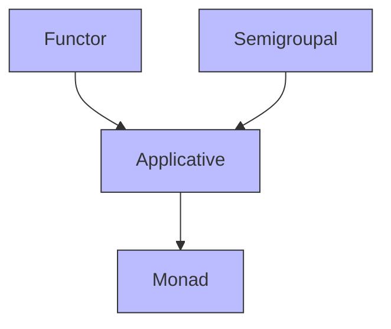

# Applicatives

## 📘 Typeclasses: Applicatives

> _“Applicatives are Functors with an added `pure` method — enabling you to lift values into a context and apply functions inside that context.”_

Applicatives sit between `Functor` and `Monad` in power. They allow you to apply a function _inside_ a context to a value _also inside_ a context — without sequencing (like `flatMap`).

They’re especially useful for validation, parallel effects, or combining independent computations.

***

### 🧩 Definition

An `Applicative` is defined by two operations:

1. **`pure`** — Lift a value into the context.
2. **`ap`** — Apply a function inside the context to a value inside the context.

In Cats, `Applicative` extends both `Functor` and `Semigroupal`.

```scala
trait Applicative[F[_]] extends Functor[F] with Semigroupal[F] {
  def pure[A](x: A): F[A]
  def ap[A, B](ff: F[A => B])(fa: F[A]): F[B]
}
```

> ✅ You can think of `Applicative` as:\
> **Functor + pure + product**

***

### 🛠️ Basic Usage in Scala (with Cats)

#### 1. Import Required Components

```scala
import cats.Applicative
import cats.instances.list._     // Provides Applicative instance for List
```

#### 2. Explicit Use of Applicative

```scala
val listApp = Applicative[List]

val aList = listApp.pure(2)      // List(2)
val result = listApp.ap(List((x: Int) => x * 2))(aList)  // List(4)
```

#### 3. Syntax Sugar (Using `.pure` and `|@|`)

```scala
import cats.syntax.applicative._   // Imports .pure
import cats.syntax.apply._         // Imports |@| and .mapN

val aSweetList = 2.pure[List]      // List(2)

// Apply multiple values using |@|
val combined = (
  List(1, 2) |@|
  List("a", "b")
).map(_ + _)  // List("1a", "1b", "2a", "2b")
```

> 💡 The `|@|` operator comes from `Semigroupal`, which `Applicative` extends — so you get tupling + mapping for free.

***

### ⚖️ Applicatives vs Monads

| Feature            | Applicative                   | Monad                           |
| ------------------ | ----------------------------- | ------------------------------- |
| Sequencing         | ❌ No dependency between steps | ✅ Steps can depend on previous  |
| Error accumulation | ✅ All errors collected        | ❌ Short-circuits on first error |
| Power              | Less powerful than Monad      | More expressive                 |
| Example            | `Validated`, `List`           | `Option`, `Either`, `Future`    |

#### Example: `Validated` — An Applicative That’s Not a Monad

```scala
import cats.data.Validated
import cats.instances.nonEmptyList._
import cats.syntax.apply._

type ErrorsOr[A] = Validated[List[String], A]

val result = (
  Validated.invalid(List("Name required")) |@|
  Validated.invalid(List("Age required"))
).tupled  // Invalid(List("Name required", "Age required"))
```

> ✅ `Validated` accumulates all errors — it doesn’t short-circuit like `Either`. It’s an `Applicative`, but **not a Monad**, because it lacks `flatMap`.

***

### 🧭 Typeclass Hierarchy (Text Version)

Based on your diagram:



> ✅ In Cats:
>
> * `Applicative` extends `Functor` and `Semigroupal`.
> * `Monad` extends `Applicative` (so every Monad is also an Applicative).
> * But not every Applicative is a Monad (e.g., `Validated`).
