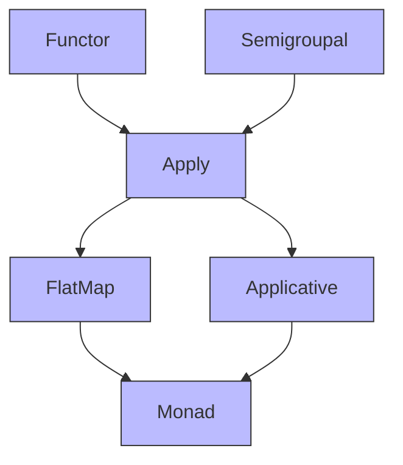

# FlatMap

## 📘 Typeclasses: FlatMap

> _“FlatMap is a weaker version of Monad — it provides the `flatMap` method but not necessarily `pure`. It sits between Apply and Monad.”_

While `Monad` gives you full power to sequence computations (`flatMap`) _and_ lift values (`pure`), `FlatMap` only requires `flatMap` — making it ideal for types that can chain operations but don’t need to create new values from scratch.

***

### 🧩 Definition

A `FlatMap` type class extends `Apply` and adds:

* **`flatMap`** — Transform a value inside a context, and flatten the result.

```scala
trait FlatMap[F[_]] extends Apply[F] {
  def flatMap[A, B](fa: F[A])(f: A => F[B]): F[B]
}
```

> ✅ So:\
> **FlatMap = Apply + flatMap**

Unlike `Monad`, `FlatMap` does **not** require `pure`.

***

### ⚖️ FlatMap vs Monad

| Feature   | FlatMap                     | Monad                      |
| --------- | --------------------------- | -------------------------- |
| `flatMap` | ✅ Available                 | ✅ Available                |
| `pure`    | ❌ Not required              | ✅ Required                 |
| Use Case  | Sequencing without lifting  | Full sequencing + lifting  |
| Example   | `NonEmptyList`, `Validated` | `Option`, `List`, `Either` |

> 📌 In Cats:
>
> * `Monad` extends `FlatMap` (adding `pure`).
> * Many types (like `NonEmptyList`) implement `FlatMap` but not `Monad` — because they can’t define `pure` meaningfully (e.g., `NonEmptyList` must have at least one element).

### 🧭 Typeclass Hierarchy (Text Diagram)

Based on your handwritten diagram:

```
Functor ────┐
            ↓
        Apply ←──── Semigroupal
            │
            ├──────────────┐
            ↓              ↓
        FlatMap       Applicative
            │              │
            └──────┬───────┘
                   ↓
                 Monad
```



> ✅ In Cats:
>
> * `FlatMap` and `Applicative` both extend `Apply`.
> * `Monad` extends both `FlatMap` and `Applicative`.
> * This means every `Monad` is also a `FlatMap`, `Applicative`, `Apply`, `Functor`, and `Semigroupal`.

***

### 🛠️ Basic Usage in Scala (with Cats)

#### 1. Import Required Components

```scala
import cats.FlatMap
import cats.instances.option._   // Provides FlatMap instance for Option
```

#### 2. Explicit Use of FlatMap

```scala
val flatMapOption = FlatMap[Option]

val result = flatMapOption.flatMap(Some(2)) { x =>
  if (x > 0) Some(x + 1) else None
}  // Some(3)
```

#### 3. Syntax Sugar (Using `for` comprehensions or `.flatMap`)

```scala
import cats.syntax.flatMap._   // Imports .flatMap
import cats.syntax.functor._   // Imports .map

val result = for {
  x <- Some(2)
  y <- if (x > 0) Some(x + 1) else None
} yield y  // Some(3)
```

***

### 🧪 Try It Yourself

```scala
import cats.FlatMap
import cats.instances.option._
import cats.syntax.flatMap._

val flatMapOpt = FlatMap[Option]

// Chain operations
val result = flatMapOpt.flatMap(Some(5)) { x =>
  Some(x * 2)
}  // Some(10)

// Using for-comprehension
val doubled = for {
  x <- Some(3)
  y <- Some(x + 1)
} yield y * 2  // Some(8)
```
