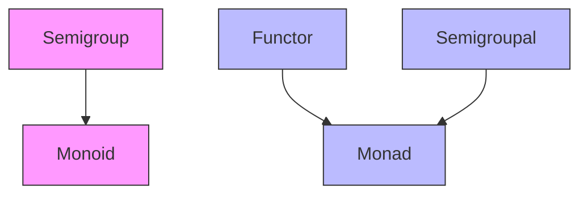

# Relationships 1

## 📘 Typeclass Relationships: Monads, Semigroups, Semigroupal & Functor

> _“Understanding how typeclasses relate helps you choose the right abstraction for your problem — and avoid confusion between similar concepts.”_

This note clarifies key relationships and distinctions between core functional programming typeclasses.

***

### 🔗 Monads Extend Semigroupals

Monads inherit from `Semigroupal` (in Cats), meaning they can combine values using `.product` or `|@|`.

```scala
import cats.Monad
import cats.instances.option._
import cats.syntax.semigroupal._

val monad = Monad[Option]

// Since Monad extends Semigroupal, we can use |@|
val combined = (Some(1) |@| Some("hello")).tupled  // Some((1, "hello"))
```

> ✅ The `product` method in `Monad` is implemented in terms of `map` and `flatMap`:

```scala
def product[A, B](fa: F[A], fb: F[B]): F[(A, B)] =
  fa.flatMap(a => fb.map(b => (a, b)))
```

***

### ⚖️ Not All Semigroupals Are Monads

Some types implement `Semigroupal` but not `Monad` — because they don’t need sequencing or flattening.

#### Example: `Validated`

```scala
import cats.data.Validated
import cats.Semigroupal
import cats.instances.nonEmptyList._   // For combining errors
import cats.syntax.semigroupal._

type ErrorsOr[A] = Validated[List[String], A]

val result = (
  Validated.valid("Alice") |@|
  Validated.valid(30)
).tupled  // Valid(("Alice", 30))

val failed = (
  Validated.invalid(List("Name required")) |@|
  Validated.invalid(List("Age required"))
).tupled  // Invalid(List("Name required", "Age required"))
```

> 💡 `Validated` accumulates errors — it doesn’t short-circuit like `Either`. It’s a `Semigroupal`, but **not a Monad**, because it doesn’t support `flatMap` (which would require choosing one error).

***

### 🧭 Don’t Confuse: Semigroup vs Semigroupal

| Concept         | Purpose                               | Operation         |
| --------------- | ------------------------------------- | ----------------- |
| **Semigroup**   | Combine two values _of the same type_ | `combine(a, b)`   |
| **Semigroupal** | Combine two values _inside contexts_  | `product(fa, fb)` |

> 📌 Think of it as:
>
> * **Semigroup** → “Combining” (e.g., `1 + 2`)
> * **Semigroupal** → “Tupling” (e.g., `(Some(1), Some("a"))` → `Some((1, "a"))`)

***

### 🧩 Typeclass Hierarchy Diagram (Text Version)

Here’s the relationship based on your drawing:



> ✅ In Cats:
>
> * `Monad` extends both `Functor` and `Semigroupal`.
> * `Monoid` extends `Semigroup`.
> * `Semigroupal` is independent of `Semigroup` — they serve different purposes.

***

### 📌 Summary Table

| Typeclass     | Key Methods        | Extends                  | Use Case                       |
| ------------- | ------------------ | ------------------------ | ------------------------------ |
| `Semigroup`   | `combine`          | —                        | Combining values (e.g., `+`)   |
| `Monoid`      | `combine`, `empty` | `Semigroup`              | Safe reduction (incl. empty)   |
| `Functor`     | `map`              | —                        | Transforming values in context |
| `Semigroupal` | `product`          | —                        | Tupling values in context      |
| `Monad`       | `pure`, `flatMap`  | `Functor`, `Semigroupal` | Sequencing effects, nesting    |
