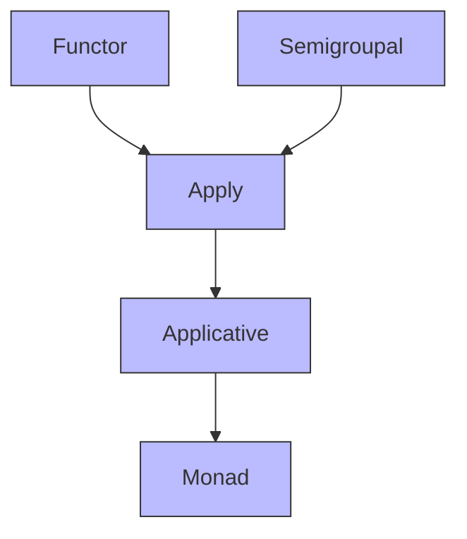

# Relationships 2

### 🧭 Typeclass Hierarchy (Text Version)

Based on your handwritten diagram:

> ✅ In Cats:
>
> * `Apply` extends both `Functor` and `Semigroupal`.
> * `Applicative` extends `Apply` (adding `pure`).
> * `Monad` extends `Applicative` (adding `flatMap`).

This means:

* Every `Monad` is an `Applicative`, which is an `Apply`, which is a `Functor` and `Semigroupal`.
* But not every `Apply` is an `Applicative` (e.g., `Validated`).
* Not every `Applicative` is a `Monad` (e.g., `List` is both, but `Validated` is only `Applicative`/`Apply`).

***

### 🔁 Why This Hierarchy Matters

Understanding this chain helps you:

* Choose the right abstraction for your use case.
* Avoid over-engineering (don’t require `Monad` if `Apply` is enough).
* Recognize when a type can’t be a `Monad` (like `Validated`) — because it doesn’t need sequencing.
