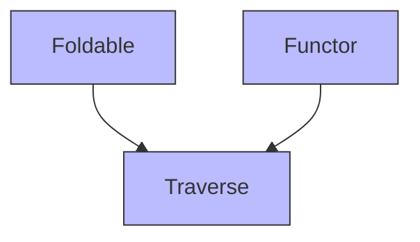

# Traverse

## 📘 Typeclasses: Traverse

> _“Traverse is a higher-kinded type class that provides ‘inside-out’ functions — allowing you to flip the structure of nested containers (e.g., `List[Option[A]]` → `Option[List[A]]`).”_

`Traverse` combines the power of `Functor` and `Foldable` with `Applicative` to enable “inverting” or “swapping” layers of context — making it essential for data validation, parallel effect handling, and generic data transformation.

***

### 🧩 Definition

A `Traverse[F[_]]` provides:

* **`traverse`** — Apply a function that returns an `Applicative` context, and invert the structure.
* **`sequence`** — A special case of `traverse` using `identity`.

```scala
trait Traverse[F[_]] extends Functor[F] with Foldable[F] {
  def traverse[G[_]: Applicative, A, B](fa: F[A])(f: A => G[B]): G[F[B]]
  def sequence[G[_]: Applicative, A](fga: F[G[A]]): G[F[A]] = traverse(fga)(identity)
}
```

> ✅ So:\
> **Traverse = Functor + Foldable + traverse/sequence**

This lets you turn `F[G[A]]` into `G[F[A]]` — effectively “flipping” the container layers.

***

### ⚖️ traverse vs sequence

| Method     | Signature                     | Use Case                                  |
| ---------- | ----------------------------- | ----------------------------------------- |
| `traverse` | `F[A] → (A → G[B]) → G[F[B]]` | Transform each element and invert context |
| `sequence` | `F[G[A]] → G[F[A]]`           | Invert context without transforming       |

> 💡 Think of `sequence` as:\
> `traverse(container)(identity)`

***

### 🛠️ Basic Usage in Scala (with Cats)

#### 1. Import Required Components

```scala
import cats.Traverse
import cats.instances.list._     // Provides Traverse instance for List
import cats.instances.option._   // Provides Applicative instance for Option
import cats.syntax.traverse._    // Imports .traverse, .sequence
```

#### 2. Explicit Use of Traverse

```scala
val listTraverse = Traverse[List]

// Traverse: List[Int] → (Int → Option[String]) → Option[List[String]]
val result = listTraverse.traverse(List(1, 2, 3)) { x =>
  if (x > 0) Some(x.toString) else None
}  // Some(List("1", "2", "3"))

// Sequence: List[Option[Int]] → Option[List[Int]]
val nested = List(Some(1), Some(2), Some(3))
val flipped = listTraverse.sequence(nested)  // Some(List(1, 2, 3))
```

#### 3. Syntax Sugar (Using `.traverse` and `.sequence`)

```scala
val numbers = List(1, 2, 3)

// Using .traverse
val strings = numbers.traverse { x =>
  if (x > 0) Some(x.toString) else None
}  // Some(List("1", "2", "3"))

// Using .sequence
val optionalNumbers = List(Some(1), Some(2), Some(3))
val combined = optionalNumbers.sequence  // Some(List(1, 2, 3))
```

***

### 🧭 Typeclass Hierarchy (Text Diagram)

Based on your handwritten diagram:



> ✅ In Cats:
>
> * `Traverse` extends both `Functor` and `Foldable`.
> * It requires an `Applicative` instance for the target context (`G`).
> * This makes `Traverse` one of the most powerful type classes — enabling structural inversion and parallel computation.

***

### 📌 Why Use Traverse?

* **Inversion**: Turn `List[Option[A]]` into `Option[List[A]]` — essential for validation.
* **Parallelism**: Apply effects in parallel (since `Applicative` doesn’t require sequencing).
* **Composability**: Chain traversals with maps, filters, etc.
* **API Design**: Build generic APIs that work across containers.

***

### 🧪 Try It Yourself

```scala
import cats.Traverse
import cats.instances.list._
import cats.instances.option._
import cats.syntax.traverse._

// Validate a list of inputs
val inputs = List(1, 2, 3)
val validated = inputs.traverse { x =>
  if (x % 2 == 0) Some(s"Even: $x") else None
}  // None (because 1 and 3 are odd)

// Flip nested structure
val nestedOpts = List(Some(1), Some(2), Some(3))
val result = nestedOpts.sequence  // Some(List(1, 2, 3))
```
